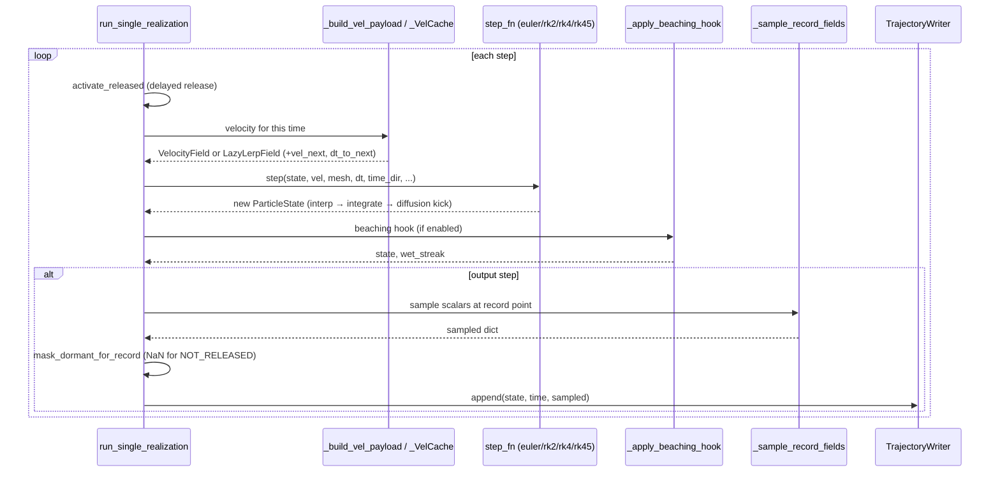

# KELP architecture

> **Covers:** the end-to-end structure of a tracking run — the data-flow
> pipeline, the per-step call sequence, and the three core data structures.
> **Does not cover:** the method internals (see `localization.md`,
> `velocity_interpolation.md`, `time_integration.md`, `vertical.md`,
> `diffusion.md`, `beaching.md`, `coordinate_frame.md`, `field_sampling.md`,
> `io_and_time.md`); config keys (see `configuration.md`).
> **Code:** `src/kelp/tracking.py:run_tracking`,
> `src/kelp/tracking.py:run_single_realization`.
> **Verified at:** see `docs/doc_map.yaml` (stamped via check_doc_sync --bless).

`kelp` is a Lagrangian particle tracker for unstructured ocean meshes. It
reads a time series of model velocity fields, releases a set of particles at
chosen positions, and advances each particle through the flow one time step at
a time, writing the resulting trajectories to disk. This document explains how
the pieces fit together: the order in which the run is assembled, what happens
inside a single step of the loop, and the three data structures every other
part of the code is built around. It is the map; the individual subsystem
documents (linked at the end) are the territory.


## 1. Pipeline overview

A run is driven by a configuration object and assembled in one place,
`run_tracking` (`src/kelp/tracking.py:run_tracking`). The configuration is
an `AppConfig` produced by `load_config` from a YAML file; it groups the run
into five sections — `mode`, `numerics`, `mesh`, `data`, `time` — each parsed
into its own small dataclass. (Every key is documented in
`configuration.md`; this overview only names the ones the pipeline acts on.)

`run_tracking` builds the run in the following order.

1. **Pick the reader.** `get_reader(config.mesh.type)` returns the reader for
   the model family named in the config — currently `"fesom2"` (z-level
   coordinates), `"fesomc"` (sigma coordinates), `"healpix"` (HEALPix products,
   the mesh built from the data store; 2-D and 3-D — `healpix.md`), or `"nemo"`
   (structured C-grid mapped onto a quad mesh; 2-D, E/N-aligned). The reader is a small set of
   static functions that know how to turn that model's files into the generic
   structures the rest of the code consumes, so no domain-specific knowledge
   leaks past this boundary.

2. **Load the mesh.** `reader.load_mesh(config.mesh)` reads the model grid and
   returns a `Mesh`. As part of this, the spatial search structures used to
   locate which mesh cell a particle sits in are built (`build_search`): a
   grid-hash index always (with the node coordinate table `Mesh._node_xyz`
   its nearest scans read, since 2026-09-22), and a KD-tree lazily on first
   fallback use. `run_tracking` then sets the exact-nearest flag and the
   hash cell — an explicit `mesh.grid_hash_cell_size`, or the measured
   choice of `mesh.grid_hash_cell_rule` (`occupancy` by default; see
   `localization.md` §3) — and stamps the resolved cell in the output
   metadata. Whenever `mode.max_levels` is set (2-D layered runs included),
   the vertical interfaces `mesh.sigma` are trimmed to that many levels from
   the surface down (`tracking._apply_max_levels`: the uncut table is kept in
   `mesh.metadata["sigma_full"]` and every cut is taken from it).
   `mode.uv_vertical` is checked against the mesh and the reader here, before
   the dataset is opened (`vertical.md` §2.1).

3. **Open the dataset.** `reader.open_dataset(config.data.ncinput, ...)` opens
   the velocity file (or directory of files) as an xarray dataset, without yet
   reading any velocity data — individual time snapshots are read on demand
   during the loop. A reader with the optional hook `prepare(mesh, ds)` gets it
   called right after (`tracking._prepare_dataset`), before anything reads the
   dataset on the mesh and before any output file exists; each realization
   calls it again at its entry (`run_single_realization`, after the
   `max_levels` cut), so a run with R realizations prepares 1 + R times. The
   engine keeps no record of what a mesh was prepared for.

4. **Load the seed particles.** `read_seeds_with_release(config.data.inicloud)`
   reads the initial positions (`lon lat [depth] [release_sec]`); once `dt` is
   known the `ParticleState` is built by `build_release_state` (delayed-release
   aware — not-yet-released particles start frozen as `NOT_RELEASED`).
   On a rotated mesh these geographic seed coordinates are rotated into the
   mesh's own frame here (`_maybe_rotate_seeds`); on an ordinary geographic
   mesh this is a no-op and the state object is returned unchanged.

5. **Resolve time.** The file's time coordinate is inspected
   (`extract_time_info`) to recover the spacing between snapshots (`file_dt`)
   and, when the tracking step `dt` is not given explicitly, to auto-detect it.
   For time-averaged model output (`data.time_averaging: mean`) the file
   timestamps mark the *end* of each averaging window, so they are shifted to
   the window midpoints (`_shift_to_midpoints`) — the velocity is effectively
   valid at the middle of the window it averages. A `start_date` /
   `duration_days` request is converted to a start index and step count here.

6. **Run the realizations.** The simulation may consist of several independent
   realizations (`time.num_runs`), each starting `time.run_interval` snapshots
   later than the last. For each one, `run_tracking` optionally opens a
   `TrajectoryWriter` for the output file (`.nc` for NetCDF, `.zarr` for Zarr;
   multi-realization runs get a `_rN` suffix per realization), stamps the run
   metadata onto it, and calls `run_single_realization` to execute the step
   loop. The writer is always closed afterwards, even on error.

Each realization is the loop inside `run_single_realization`
(`src/kelp/tracking.py:run_single_realization`); its per-step structure is
the subject of §2. Output streams to the writer step by step rather than being
held in memory, so long runs on large meshes stay bounded in memory.

```mermaid
flowchart TD
    cfg[config.yaml] -->|load_config| AC[AppConfig]
    AC -->|get_reader(mesh.type)| R[Reader: fesom2 / fesomc / healpix / nemo]
    R -->|load_mesh| M[Mesh + build_search]
    R -->|open_dataset| DS[xarray Dataset]
    AC -->|build_release_state| PS[ParticleState]
    M --> RT[run_tracking]
    DS --> RT
    PS --> RT
    RT -->|per realization| RSR[run_single_realization loop]
    RSR -->|append per output step| W[TrajectoryWriter]
    W --> OUT[(.nc / .zarr)]
```


Three reader-agnostic switches are applied by `run_tracking` right after `load_mesh`, before
anything reads the mesh, in this order: `mesh.exact_nearest` → `core.mesh.set_exact_nearest`
(the exact nearest-node anchor guard; `localization.md`), then either an explicit
`mesh.grid_hash_cell_size` → `core.mesh.set_grid_hash_cell` (pinned in `mesh.metadata`,
survives rebuilds) or the automatic choice `mesh.grid_hash_cell_rule` →
`core.mesh.apply_grid_hash_cell_rule` (its mode depends on the guard, hence the order). A
driver that calls `load_mesh` directly must apply them itself.

## 2. Per-step call sequence

`run_single_realization` advances the particle state one tracking step at a
time. Every step does the same things in order: release the particles whose
delayed-release step has come (`activate_released`: NOT_RELEASED → ALIVE), get
the velocity for this moment, move the particles, fold them back into the
periodic window (when configured), optionally apply the beaching rules, and —
on output steps — sample any requested scalar fields and append the snapshot to
the writer (still-dormant particles written as NaN positions,
`mask_dormant_for_record`; velocities of particles not alive through the whole
step written as NaN, `mask_inactive_velocity`; the record labelled with the time
at the end of the step — output format 2, `io_and_time.md` §5).

**Building the velocity payload.** The first job of each step is to obtain the
velocity field the integrator will use. There are two modes, and the
distinction matters for everything downstream.

- *Discrete mode* (the default) advances exactly one file snapshot per tracking
  step: step `i` reads the velocity at file index `start + i·direction`, while
  the particles move by the configured `dt`; a `dt` unlike the record spacing is
  therefore refused at startup (`tracking._check_discrete_dt`). The payload is a
  plain `VelocityField` read straight from the reader.

- *Temporal-interpolation mode* (`temporal_interp: true`) lets the tracking
  `dt` be smaller than the file spacing. The simulation tracks its own clock in
  seconds; each step resolves which two adjacent snapshots bracket the current
  time (`_resolve_time_bracket`) and builds a blended payload from them
  (`_build_vel_payload`). When the time sits strictly between two snapshots the
  payload is a `LazyLerpField` — a view over the two snapshots that blends each
  field only when something actually reads it, so a step that touches only a
  few fields pays only for those (see §3 and `io_and_time.md`).

In both modes the reads go through a small snapshot cache (`_VelCache`, by
default holding the two bracketing snapshots, more with `numerics.prefetch_size`)
so a snapshot is not re-read when it is reused across consecutive steps —
important when cycling over a few snapshots on a large mesh. When the run is time-aware,
the payload also carries the *next* snapshot the step is moving toward
(`vel_next`) and the time remaining to it (`dt_to_next`), which the multi-stage
integrators use to evaluate velocity at their intermediate substep times.
Details of the time bracketing and lazy blending live in `io_and_time.md`.

**Stepping the particles.** The velocity payload is handed to the integrator
chosen in the config (`step_fn`, one of euler / rk2 / rk4 / rk45). A single call does
the whole position update: it interpolates the velocity to each particle's
position, integrates the new position over `dt`, and applies any stochastic
diffusion kick — returning a brand-new `ParticleState` rather than mutating the
old one (every integrator builds the result with `.replace()`; states are
immutable). Particles that leave the domain or fail interpolation are reverted
to their pre-step position and marked OUTSIDE. The velocity-interpolation
method is described in `velocity_interpolation.md` and `interpolation.md`, the
integration schemes in `time_integration.md`, the vertical motion in
`vertical.md`, and the diffusion kick in `diffusion.md`.

**Periodic fold.** With `numerics.periodic_lon`/`periodic_lat` set
(idealized channel domains), a post-step fold (`_apply_periodic_wrap`) maps
ALIVE particles that stepped past the window back into it — BEFORE the
beaching hook and recording, so both see in-window positions. The mesh must
carry a ghost band past the window (the fold adds no seam connectivity);
in-window particles are bitwise untouched, and the feature off is
byte-identical. See `configuration.md`.

**Beaching hook.** If beaching is enabled, a post-step hook
(`_apply_beaching_hook`) runs after the integrator and before the time clock
advances. It may turn particles that contacted the coast or shallow water into
BEACHED, and may release previously beached particles back to ALIVE. When
beaching is disabled the hook is skipped entirely and the path is unchanged.
See `beaching.md`.

**Recording.** Output is emitted every `output_freq` steps. On an output step,
any requested scalar fields are sampled at the post-step particle positions
(`_sample_record_fields`); on a rotated mesh the positions and velocity
diagnostics are un-rotated back to geographic on a copy for output
(`_geo_view_for_record`) while the working state stays in the mesh frame. The
snapshot is then handed to `writer.append`. Restart checkpoints are written at
the configured interval. Field sampling is covered in `field_sampling.md` and
the rotated frame in `coordinate_frame.md`.




## 3. Core data structures

Three structures carry essentially all of the run's state. Everything else in
the code reads or transforms one of them.

### `Mesh` — the static grid

Authoritative definition: `src/kelp/core/mesh.py:Mesh`.

The mesh is loaded once by the reader and never changes during a run. It holds
the unstructured grid geometry and the connectivity needed to find which cell a
particle is in.

| field | shape / type | meaning |
|---|---|---|
| `nodes_lon`, `nodes_lat` | `(N,)` | node coordinates, degrees |
| `depth` | `(N,)` | bottom depth at each node, metres, **positive-down** |
| `elem_nodes` | `(E, max_verts)` int | element→node connectivity, **0-based, -1 padded** (FESOM2 max_verts=3; FESOM-C 4) |
| `elem_center_lon`, `elem_center_lat` | `(E,)` | element centre coordinates |
| `node_to_elems`, `node_to_elems_count` | `(N, max_conn)`, `(N,)` | node→element adjacency (the local stencil) |
| `sigma` | `(K,)` | vertical interfaces — physical depths for z-level meshes, sigma values for sigma meshes; empty for 2D |
| `vertical_coord` | `"zlevel"` / `"sigma"` | selects the vertical-geometry backend |
| `rotation_angles` | `(α,β,γ)` or `None` | the Euler frame the coordinates live in; `None` = geographic |
| `metadata` | `dict` | reader and run facts: e.g. the HEALPix u/v data prefix `uv_data_last` (int `(N,)`), the uncut level table `sigma_full`; shared by shallow copies of the mesh |

The spatial search index (grid hash with its `(N, 3)` node coordinate table
`_node_xyz`, plus a lazily built KD-tree) is attached to the mesh by
`build_search` during `load_mesh`. Several other quantities —
element areas, coastal-element flags, the depth-linear data-point tables
(`_uv_depth_points`, valid while `sigma`, `depth` and `metadata["uv_data_last"]`
are the objects they were built from — the declaration as the engine's own
read-only snapshot, installed there at the build; replaced, never mutated, so
a shallow copy never sees another's rebuild) — are computed lazily and cached on the
mesh the first time a subsystem needs them.

### `VelocityField` — one time snapshot of the flow

Authoritative definition: `src/kelp/core/io.py:VelocityField`.

A `VelocityField` is the velocity (and associated fields) at one instant,
produced by `reader.read_velocities`.

| field | shape | meaning |
|---|---|---|
| `u`, `v` | `(E,)` 2D / `(K-1, E)` 3D | horizontal velocity; mesh location given by `uv_layout` (`"element"` or `"node"`); `(K, N)` for level data (below) |
| `uv_vertical` | `"layer"` / `"layer_linear"` / `"level"` | vertical placement of `u`/`v`: layer centres read per layer (default), layer centres read linearly in depth, or levels read linearly in depth (`vertical.md` §2.1) |
| `eta` | `(N,)` | sea-surface height at nodes |
| `w` | `(K, N)` or `None` | vertical velocity at interfaces; `None` for 2D |
| `t` | `float` or `None` | the snapshot's time, when the reader sets it |
| `kh_zonal`, `kh_meridional` | `(N,)` / `(E,)` or `None` | horizontal diffusivities; both present together or both absent |
| `kh_layout` | `"node"` / `"element"` or `None` | mesh location of the Kh fields |
| `scalars` | `dict` or `None` | optional node-based scalar fields for trajectory sampling |
| `az` | `(K, N)` or `None` | vertical diffusivity at interfaces (`diffusion.var_az`) |

The constructor checks the placement against the shapes: a 2-D field (`u`
1-D) is always `"layer"`; `"level"` and `"layer_linear"` need node layout,
with or without `w`; with `w` present, `"layer"`/`"layer_linear"` need
`K-1` rows of `u` and `"level"` needs `K` (so FESOM2 u/v delivered on the
levels raise instead of running on their first `K-1` rows). The private
`_dl_token` is the depth-linear record check's stamp (the mesh table the field
passed); every rebuild through the constructor drops it, and a blend keeps it
only when all its parents hold the SAME token (`_shared_token`). Every blend
(`lerp`, `LazyLerpField`, the PCHIP reconstruction) carries `uv_vertical` and
refuses parents of mixed placement (`_require_same_uv_vertical`); the shared
snapshot cache carries it in its metadata (never the token).

`VelocityField.lerp` produces the time-interpolated blend of two snapshots.
`LazyLerpField` (`src/kelp/core/io.py:LazyLerpField`) is its lazy
counterpart: a view over two snapshots and a blend weight that materializes
each field only on first access and caches the result. The blended values are
bit-identical to the eager `lerp`; the laziness exists purely so a step that
reads only `eta`, or whose fused kernel reads the two raw snapshots directly,
does not pay to blend `u`/`v`/`w` it never touches. This is the payload type
the temporal-interpolation path hands the integrator (§2).

### `ParticleState` — the particles, at one moment

Authoritative definition: `src/kelp/core/particles.py:ParticleState`.

`ParticleState` is the only structure that changes during the loop, and it
changes by replacement, not mutation: each integrator step returns a new
`ParticleState` built with `.replace()`, leaving the previous one intact (this
is what lets the beaching hook compare against the pre-step status cheaply).

| field | shape | meaning |
|---|---|---|
| `lon`, `lat` | `(P,)` | particle positions, degrees |
| `z` | `(P,)` | depth, metres positive-down (zero in 2D) |
| `status` | `(P,)` int32 | `ParticleStatus`: ALIVE / BEACHED / OUTSIDE / NOT_RELEASED (delayed release — frozen until its step, written as a gap) |
| `nearest_node` | `(P,)` int | cached nearest mesh node (-1 = unknown) |
| `u`, `v`, `w` | `(P,)` or `None` | last interpolated velocity at the particle (flows to output as `vel_*`, NaN where the particle was not alive through the step; no `w` in 2-D) |
| `failure_reason` | `(P,)` int8 or `None` | per-particle reason a particle died (populated by all integrator paths — fused kernels included since 2026-08) |
| `elem` | `(P,)` int32 or `None` | carried containing element (`elem_search: walk`); `None` otherwise |
| `release_step` | `(P,)` int32 or `None` | delayed-release activation step; `None` without a delayed release |
| `release_lon`, `release_lat`, `release_z` | `(P,)` float64 or `None` | release position in the mesh frame, set when the run starts at global step 0, checkpointed; written (geographic) as the output's `release_*` variables. `None` only for a state resumed from a restart older than output format 2 |

A `ParticleState` is seeded from the initial-position file at the start of the
run and is the object passed into, and returned from, every integrator step.


## 4. Where to go next

Each subsystem has (or will have) its own focused document. This overview only
names the boundaries; the depth lives there.

- **`localization.md`** — how a particle's position is mapped to a mesh node
  and containing element (the grid-hash / KD-tree search and containment test).
- **`velocity_interpolation.md`** — how `u`/`v` are interpolated from the mesh
  to a particle position (least-squares and barycentric methods).
- **`time_integration.md`** — the Euler / RK2 / RK4 schemes and how the
  multi-stage integrators evaluate velocity at intermediate substep times.
- **`vertical.md`** — 3D vertical motion: z-level and sigma column geometry and
  the vertical-velocity interpolation.
- **`diffusion.md`** — the stochastic diffusion kick: uniform / Euler-Maruyama /
  Milstein schemes, composition modes, and the counter-based RNG.
- **`beaching.md`** — the beaching criteria, the post-step hook, and tidal
  resuspension.
- **`coordinate_frame.md`** — the optional rotated coordinate frame for
  pole-safe tracking, and why output is always geographic.
- **`field_sampling.md`** — sampling temperature, salinity, or any node-based
  scalar along trajectories.
- **`io_and_time.md`** — time-coordinate handling, the snapshot cache, the time
  bracketing and lazy blending, and the trajectory writer / restart format.
- **`interpolation.md`** *(exists)* — formula-level reference for every
  interpolation method, keyed by config option.
- **`configuration.md`** *(exists)* — the full YAML configuration reference:
  every option, the file-discovery rules, and the common pitfalls.
