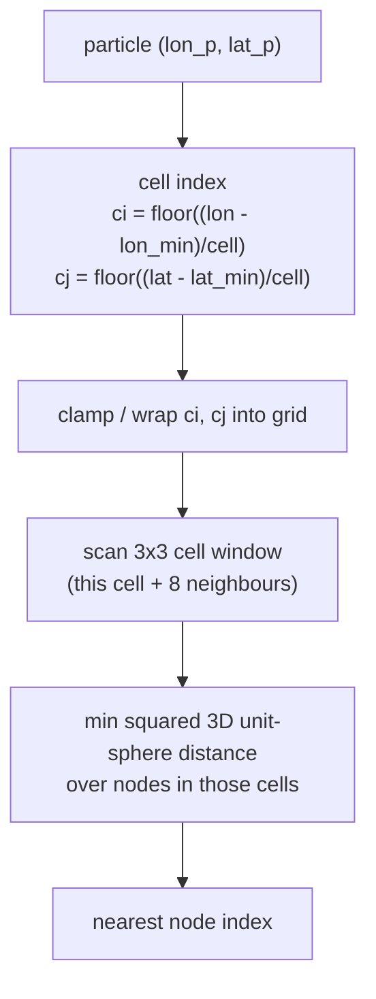

# KELP localization

> **Covers:** how a particle position maps to a nearest mesh node and its containing element — the grid-hash search, the lazy KD-tree fallback, and the fan-triangulation containment test.
> **Does not cover:** how velocity/scalar *values* are blended once the element is found (see `velocity_interpolation.md`, `interpolation.md` §7); the time loop (see `time_integration.md`).
> **Code:** `src/kelp/core/mesh.py:build_search`, `src/kelp/core/mesh.py:_node_xyz_fill`, `src/kelp/core/mesh.py:_grid_hash_nearest_widened`, `src/kelp/core/mesh.py:_find_containing_element_local`.
> **Verified at:** see `docs/doc_map.yaml` (stamped via check_doc_sync --bless).

This document explains *localization*: turning a particle's `(lon, lat)` into
the two facts every other part of the tracker needs — which mesh node is
nearest, and which mesh element (cell) the particle sits inside. It is the
central operation of the step loop. The companion overview is
`architecture.md`; once a particle is located, the blending of velocity or
scalar values from the surrounding nodes/elements is the subject of
`velocity_interpolation.md` and `interpolation.md` §7, not this document.

## 1. The problem

The mesh is *unstructured*: `N` nodes scattered over the sphere connected into
`E` triangular or quadrilateral elements, with no regular `(i, j)` indexing that
would let you compute which cell a point falls in from its coordinates. Yet
every tracking step, for every particle still alive, the tracker must answer two
questions:

1. **Which node is nearest** to the particle? This anchors the local stencil —
   the small set of nearby elements used for interpolation and the domain check.
2. **Which element contains** the particle? This is the domain test: a point
   with no containing element has drifted off the mesh and the particle is
   marked OUTSIDE.

A naive nearest-node search compares the particle against all `N` nodes — `O(N)`
per particle per step. On a global ocean mesh that is millions of nodes, run
once per particle per step, possibly for thousands of steps. That is far too
slow. Localization must be effectively `O(1)` per query, independent of mesh
size. The two structures below — a uniform grid hash for the nearest node, and
the node→element adjacency for the containment scan — make it so.

## 2. Mesh representation

Localization relies on a handful of `Mesh` fields
(`src/kelp/core/mesh.py:Mesh`; the full structure is tabulated in
`architecture.md` §3):

- **`nodes_lon`, `nodes_lat`** `(N,)` — node coordinates in degrees. The
  nearest-node search works directly on these.
- **`elem_nodes`** `(E, max_verts)` — element→node connectivity, **0-based and
  `-1` padded**. FESOM2 elements are triangles (`max_verts = 3`); FESOM-C allows
  quads (`max_verts = 4`), where a triangle is stored either with its fourth
  slot repeating the first node or set to `-1`. The containment test reads the
  vertex coordinates of a candidate element from here, after compacting away the
  pad/repeat.
- **`elem_neighbors`** (`build_elem_neighbors`, lazy `(E, max_verts)` int32
  cache) — the element across each local edge of the compacted vertex ring,
  `-1` on boundary edges; FESOM's own adjacency array reconstructed from the
  connectivity. Not used by the nearest-node/containment machinery of this doc;
  it is the stencil table of the `edge_leastsq` u/v method
  (`interpolation.md` §1.2) and the side-lookup for edge-walk tracking.
- **`node_to_elems`, `node_to_elems_count`** `(N, max_conn)` `-1` padded, and
  `(N,)` — the **node→element adjacency**: for each node, the list of elements
  that touch it. This is the bridge from a nearest node to a small candidate set
  of elements (typically ~6 around an interior node), so the containment test
  never scans more than that handful. It is built once by
  `build_node_to_elems` (argument-order trap: `n_nodes` comes first).

The search index itself (§3, §4) is attached to the mesh by `build_search`
during `load_mesh`, so by the time the step loop runs everything is in place.

## 3. Grid-hash nearest-node search

The nearest-node query is served by a **uniform grid hash**, built eagerly by
`build_search` → `build_grid_hash` (`src/kelp/core/mesh.py:build_grid_hash`)
and queried by `_grid_hash_nearest_3x3` (batch/exact core) / `_grid_hash_nearest_widened` (single-particle numba callers)
(`src/kelp/core/mesh.py:_grid_hash_nearest_widened`). The whole structure is
plain integer/float arrays so the query runs inside Numba-compiled (`@njit`)
kernels — unlike a scipy KD-tree, which cannot be called from compiled code.

### Building the grid

`build_grid_hash` lays a regular lon/lat cell grid over the mesh extent and
buckets every node into the cell it falls in:

- **Cell size.** When not given, the reader's build auto-chooses it from
  mesh density as `sqrt(domain_area / N) * 2`, clamped to a floor of `0.05°`
  — roughly twice the MEAN node spacing (the `domain_area` is the lon-span
  times lat-span of the mesh's bounding box, land included), so on a mesh
  refined where the particles are the window holds far more nodes than the
  scan needs (CORE2: 67 nodes median, 189 at p95, at the particles). This
  is the **legacy** cell. **Since 2026-09-22 the tracking entry points then
  apply `mesh.grid_hash_cell_rule`** (`run_tracking`, `track_particles`,
  `kelp info`; a driver calling `load_mesh` directly applies it itself, like
  the explicit cell and the exact-nearest flag): `choose_grid_hash_cell`
  finds the exact nearest node of ≤ 200 000 sampled element centres once
  (θ and the cap's longitude extent are cell-independent), then evaluates a
  ladder of candidate cells (legacy / √2ᵏ, k = 0..12) WITHOUT rebuilding
  the hash — node counts per cell, a 2-D prefix sum, the 3×3 occupancy at
  each centre, the empty-window share, the share the exact search must
  widen (its own certificate, `_anchor_provable_rect` on the 3×3 window;
  an empty window or one without the true nearest widens too), the share a
  plain 3×3 scan would get wrong (true nearest outside the window), and a
  scan-cost proxy: a
  provable hit costs its window (occupancy + 9 cells + one certificate, weight 20); otherwise the node
  count of the rectangle the certificate needs (`rx = ceil(ext/cell)`, `ry
  = ceil(θ/cell)`, all columns at the pole) plus the cells the growth visits
  (each new column pair over the current rows, each new row as a slice) plus
  one certificate evaluation per growth iteration (`max(rx, ry) + 1`, weight
  `_GH_COST_CERT = 20` nodes; calibrated 2026-09-22 against the measured
  exact batch search per candidate on CORE2 and a 80–88 °N structured mesh —
  without it the argmin sat one ladder step below the measured optimum).
  Choice by the guard mode: `exact_nearest` on → the smallest mean scan
  cost (an empty window only costs the widening, the anchor stays exact)
  among the candidates inside the proxy's validity domain — widening share
  ≤ 20 % and hash offsets ≤ 128 MB per process (on the 11.5 M-node global
  mesh the unbounded argmin was the cap-limited last candidate: 46 M cells,
  185 MB, 21 % widening, predicted 5.9× where 1.4–3.1× was measured; the
  legacy row is always eligible) — taken only when it predicts at least
  `min_gain` = 2.75× over the legacy cell, the mid-gap between the two
  calibrated classes: quasi-uniform meshes predict 2.0–2.2× (HEALPix CORE2
  twins, CORE2 itself), which buys ~1.6× on the search in isolation and
  nothing measurable on the step of a global release, while high-latitude
  particles (widening) and land seeds (the far budget) pay measurably
  (HEALPix 80–88 °N +17–24 %, seeds in a 20° land cap ×3.5), so they keep
  the legacy cell; structure-resolving meshes predict ≥ 3.6× and act;
  off → the smallest cell with no empty window, median ≥ 8, no more
  approximate anchors than legacy (+0.5 points) and the same memory bound,
  because the fused kernels then take the 3×3 best (a smaller cell may also
  lose the density certificate that gates the fused bary-tinterp kernels —
  unfused, correct, one warning). Hard limits: `far_rows ≤ 64` (the legacy
  candidate is evaluated even beyond it) and the 50 M-cell cap. Deterministic;
  the choice is pinned like an explicit cell and printed
  (`describe_grid_hash`). Measured (exact search, anchors identical at
  every cell; `benchmarks/grid_hash_cell_rule_table.md`): CORE2 keeps 1.38°
  (predicted 2.2×; the search would gain 1.6× at 0.49–0.69°, the fused step
  of a 60-day daily-step run of 200 000 global particles nothing measurable,
  and the runs are bitwise identical — an Arctic release gains 28 % per step
  at the explicit 0.5°); the FESOM-C North Sea mesh `sns_multi_m8` 0.058° →
  0.014° (window 207 → 13 nodes, search 1.7×); the 11.5 M-node global FESOM2
  mesh 0.145° → 0.051° (window 483 → 62, search 1.7–2.6×, hash offsets 12 →
  92 MB per process, the chooser 3 s); a synthetic estuary (0.0005° coastal
  strip, 0.05° offshore) 0.05° → 0.0016°, the strip's scan cost ÷ 30 (×26
  measured) while the 0.5 % offshore centres pay ring growth.
  `legacy` keeps the reader's cell bit for bit; the resolved cell is always
  in the output metadata. The sample is the mesh, not the seeds — a release
  confined to the coarse part of a multi-resolution mesh may still prefer
  an explicit cell (`utils/check_grid_hash_cell.py` probes seeds). Two
  cell-dependent regimes remain by contract: an exact tie between two
  nearest nodes is broken by scan order, and a query farther from every node
  than the far budget (`max_edge/cell + 2` rows — an RK stage carried tens
  of degrees off the mesh by a monthly step, a deep-land seed) gets the best
  node SEEN, not the true nearest; both change with the cell (6 of 200 000
  CORE2 particles differed after 11 monthly steps, none after 60 daily
  ones).
- **Longitude branch.** Longitudes are indexed in whichever branch — `[0, 360)`
  or `[-180, 180)` — keeps the mesh *contiguous*, so a regional mesh that
  crosses the prime meridian and one that crosses the dateline both index
  cleanly (the branch with the smaller span is the unfragmented one). A
  near-global mesh (span > 350° in both branches) instead gets a **cyclic** grid
  spanning exactly 360°, so the query-side index wrap at the seam is an exact
  ±360° shift.
- **Bucketing.** Nodes are sorted into cells in CSR form: `_gh_offsets`
  (`n_cells + 1` prefix-sum offsets) and `_gh_node_ids` (node indices grouped by
  cell). Looking up a cell gives the contiguous slice of node ids in it.

For a non-cyclic grid the cell column/row of a point are

$$
\mathrm{ci} = \left\lfloor \frac{\mathrm{lon} - \mathrm{lon\_min}}{\mathrm{cell}} \right\rfloor,
\qquad
\mathrm{cj} = \left\lfloor \frac{\mathrm{lat} - \mathrm{lat\_min}}{\mathrm{cell}} \right\rfloor,
$$

where `lon_min`/`lat_min` are the (one-cell-padded) grid origin.

### Querying

`_grid_hash_nearest_3x3(lon_p, lat_p, …)` (via the shared `_gh_cell_of`) maps the query point to its cell
`(ci, cj)` — first normalising the longitude into the grid's branch (the same
`% 360` wrap used when the hash was built, so a point near the dateline lands in
the right column) — then scans that cell **plus the ring of eight neighbouring
cells** (a 3×3 window), keeping the closest node found. It returns the index of
that node.

- **Distance metric.** Distance is computed as squared **Cartesian 3D distance
  on the unit sphere** (each lon/lat converted to `(x, y, z)`), the same metric
  the KD-tree fallback uses, so in-domain results are identical between the two
  paths and there is no dateline discontinuity in the comparison.
- **Node coordinates come from a table.** `build_grid_hash` converts every
  node to unit-sphere Cartesian coordinates once (`Mesh._node_xyz`, `(N, 3)`
  float64, 24 bytes per node; 0.28 GB on the 11.5M-node global mesh) with a
  Numba kernel (`_node_xyz_fill`) that evaluates exactly the scalar
  expressions the scans used to evaluate per candidate, so every scan — the
  3×3 window, the widening search, the exact search's row and cell scans,
  the walk loop's fallback — reads three numbers per candidate instead of
  calling `cos`/`sin` four times. The distances, the first-found-wins tie
  rule and the certificate are unchanged, so the anchors are bit-identical
  to the pre-table code (pinned kernel by kernel against frozen copies of
  the old kernels in `tests/test_node_xyz.py`). Measured on CORE2 at the
  automatic cell (80 nodes per window where particles are): 6.3× on the
  scan, 3.2 → 0.5 µs per query at one thread. The query point's own
  coordinates are still computed per query. The table is rebuilt with every
  hash rebuild, from the raw node longitudes (not the branch-folded ones
  used for cell indexing). **Precondition of the bit-identity claim:** the
  fill loop and the scans must be compiled to the same math. The six
  expressions are evaluated by Numba in both places (never by numpy or
  `math`: their cos/sin round differently in ~0.1–0.25 % of values — LLVM
  lowers a sin/cos pair of one argument that sits in one basic block to a
  single `sincos` call — and one ulp flips a near-tie anchor), each cos/sin
  pair of `_node_xyz_fill` stays in one basic block, and no vector math
  library is active (`numba.config.USING_SVML` False: Intel SVML would
  vectorise the contiguous fill loop but not the gather/argmin scans).
  `build_grid_hash` verifies this on a sample of ~4096 nodes with a loop
  shaped like the old scans (`_node_xyz_selfcheck`) and emits a
  `RuntimeWarning` naming `NUMBA_DISABLE_INTEL_SVML=1` if the table
  disagrees; the search stays exact and self-consistent either way, only
  the equality with pre-table anchors at exact ties is at stake. Memory:
  the table is per-process state — a node running k shard processes holds
  k copies (24 bytes × N each). Without Numba the table is filled by numpy
  (the KD-tree's own conversion, which serves the queries in that mode);
  bit-identity with the Numba kernels is not a contract of the fallback.
- **Why the 3×3 window is enough.** With a cell size of ~2× the node spacing,
  the true nearest node is never more than one cell away from the query cell, so
  scanning the immediate ring is guaranteed to find it for any in-domain point.
  Far out-of-domain (off-mesh) queries clamp to a boundary cell and return a
  sensible boundary node — which may differ from the global nearest, but those
  points are about to be rejected by the containment test anyway.
- **When the window is NOT enough.** The guarantee assumes node density is
  quasi-uniform *in lon/lat degrees*. On meshes whose node rows compress in
  longitude toward the poles (e.g. the HEALPix dual mesh: polar rings with
  90°/ring longitude gaps), or near-global meshes with an empty longitude
  gap wider than a cell, the 3×3 window can be entirely **empty**. With
  `mesh.exact_nearest: false` the two entry points then diverge deliberately
  (2026-08-16; under the default guard both run the exact search of §4):
  the 3×3 core (`_grid_hash_nearest_3x3`) returns `-1`, and the BATCH path
  keeps that miss so `find_nearest_nodes` answers it with the **exact**
  KD-tree (see §4) — callers of the vectorized API always get the true
  nearest. The SINGLE-particle kernel (`_grid_hash_nearest_widened`),
  which serves the fused/RK-stage numba callers where no KD-tree is
  reachable, instead **ring-widens** outward (one extra ring after the
  first hit) and returns an APPROXIMATE anchor — exact for quasi-uniform
  gaps, possibly a marginally farther node in skewed geometries — which
  is strictly better than the old `-1`: that used to kill RK stages
  probing across a seam gap for no physical reason, and worse, wrapped
  Python-style into `node_to_elems[-1]` in guardless kernels. The
  grid-hash result is untouched (byte-identical) whenever the window
  holds any node. A non-empty window can still anchor on a non-nearest
  node in the polar regime — a cold-anchor limitation documented on the
  HEALPix builder (`src/kelp/readers/healpix.py`).
  `grid_hash_dense_for_elements(mesh)`
  (`src/kelp/core/mesh.py:grid_hash_dense_for_elements`) turns the
  "never empty in-domain" property into a checkable per-mesh
  **certificate** (every element-bbox cell has a nonempty 3×3 window ⇒
  the widened single-particle anchor is bit-identical to the batch
  3×3+KD path for every containable query); with the guard off the fused
  barycentric kernels gate on it and fall back to the unfused exact path when
  it is denied (HEALPix polar rows) — see `time_integration.md` §5. Under the
  default guard the gate passes without evaluating it, because every fused
  kernel then searches exactly in-kernel.
- **Complexity.** Each query touches a fixed-size 3×3 window holding `O(1)`
  nodes for a quasi-uniform mesh, so the cost is effectively constant per query
  and independent of `N`. The batch entry point `find_nearest_nodes`
  (`src/kelp/core/mesh.py:find_nearest_nodes`) runs the same single-point
  kernel over all particles in a Numba `prange` parallel loop.

### Exactness of the 3×3 window and the `exact_nearest` guard (2026-09-12)

The 3×3 window returns the closest node **among the nodes it holds**. That is the true
nearest only when no closer node can lie outside the window. Any node closer than the
found one lies in the spherical cap of angular radius θ (the query-to-found-node distance)
around the query; the cap spans θ in latitude and `asin(sin θ / cos lat_q)` in longitude
(unbounded once |lat_q| + θ reaches a pole). The found node is *provably* nearest iff the
cap fits inside the longitude/latitude intervals the window ACTUALLY searched
(`core.mesh._anchor_provable`): the three cells around the query, where a wrap grid's last
cell is narrower than `cell` (360° is not a multiple of the cell) and a clipped row or column
reaches the grid edge, beyond which no node exists; on a non-wrap grid the ±360° images of
the cap must not reach the node range either (a near-global mesh stored on one branch: the
physically nearest node can sit at the other end of the grid). With uniform coverage this
reduces to θ ≤ cell, |lat_q| + θ < 90° and `asin(sin θ / cos lat_q)` ≤ cell
(`_nearest_provably_exact`). A **non-empty window can fail this** — at high
latitude of the mesh frame (a rotated frame stretches longitude degrees towards its pole)
or with a small explicit `mesh.grid_hash_cell_size` — and then the anchor is only
near-nearest: a different 1-ring stencil for the least-squares/W interpolation and a
trajectory that diverges from the exact-anchor run (measured on the CORE2 Beaufort
configuration with a 0.5° cell: 0.1 % of the alive particles, 2.7 % of the mesh's element
centres, 0.16 % of the statuses changed over 91 days; the automatic cell itself is
approximate for 0.005 % of that mesh).

`mesh.exact_nearest` (default `true` since 2026-09-12; `false` together with `mesh.grid_hash_cell_rule: legacy` = the pre-guard approximate anchors, bit for bit — the default rule may change the cell in that mode too) turns the guard on:
`run_tracking` calls `set_exact_nearest(mesh, True)` (stored in
`mesh.metadata["exact_nearest"]`, survives hash rebuilds); `find_nearest_nodes` then runs
the batch kernel in exact mode — every query goes through the in-kernel exact search below
(the KD-tree heal remains only for an empty mesh) — and **every fused kernel is exact too**: the
fused 2-D kernels (least-squares steady/tinterp/PCHIP, node-layout barycentric, the Euler
pair kernel) and the fused 3-D Euler kernel anchor each evaluation site (start position, RK
stage positions, final position) with the in-kernel exact search
`_grid_hash_nearest_exact` — the 3×3 hit is accepted exactly when the batch path accepts it,
otherwise the searched window is widened as a RECTANGLE driven by the certificate's deficits
(`_anchor_provable_rect`: more rows when the cap's latitude extent is uncovered, more columns
when its longitude extent is, all columns at once when the cap reaches a pole, so only the
polar rows are scanned) until the best node found is provably the nearest. Same chord metric
as the KD-tree, and the batch path (`find_nearest_nodes` under the guard) calls the same
function, so fused and unfused anchors agree bit for bit, exact ties included; no runner round
trip, no re-run — a step costs the widened scans of its unprovable anchors and nothing else.
Row segments are scanned as contiguous slices of the hash (a polar row on a fine cell is
thousands of empty cells but few nodes). Budget: `build_grid_hash` derives `mesh._gh_far_rows`
= the longest element edge in cells + 2, so a query whose nearest node is farther than that
(in latitude terms) is outside every element — seeds far outside a regional extract, a point
deep inside a land hole — and keeps the best node seen (or the plain widened-window anchor)
instead of a scan of the grid; its particle dies this step either way. A fixed budget was
wrong for the multi-resolution meshes the explicit cell exists for (coarse elements spanning
50 cells of the fine patch's cell). Seeds on land inside a regional extract cost the rings up
to the first hit at mid-latitude (cheap) and the budget band of full rows in the polar cap. (The
fused 3-D RK2 barycentric kernels run the same in-kernel search under the guard; their 2026-08
handshake — flag an unprovable stage anchor, KD-heal it in the runner, re-run the flagged subset, §6 —
now serves only the guard-off empty-window case.) Before 2026-09-12 the
2-D and 3-D Euler kernels were bypassed under the guard. `rk45` anchors its adaptive substeps
through the same per-site helper, so it is exact under the guard as well.
`utils/check_grid_hash_cell.py` reports the approximate-anchor fraction of a configuration
before a run.

## 4. Lazy KD-tree fallback

`build_search` builds the grid hash eagerly but **defers** the scipy KD-tree:
`_ensure_kdtree` (`src/kelp/core/mesh.py:_ensure_kdtree`) constructs the
`cKDTree` only on the first query that actually needs it, then caches it on the
mesh.

The KD-tree serves two fallback roles: (1) the whole-query path when the grid
hash is unavailable — in practice, when Numba is not installed, so the compiled
grid-hash kernel cannot run; and (2) per-query recovery of **grid-hash misses**
(`-1` from an empty 3×3 window, §3) — only the missed entries are re-answered,
so grid-hash successes stay byte-identical. `find_nearest_nodes` prefers the
grid hash whenever it is built and Numba is present, and only falls through to
`_ensure_kdtree` in those two cases. The
build is deferred because constructing a KD-tree over a large mesh (11M+ nodes)
costs seconds, and the overwhelming majority of runs — those with Numba — never
touch it. Building it lazily means that cost is paid only when something forces
the fallback, never on a normal run. (The tree uses the same unit-sphere
Cartesian coordinates as the grid hash, so the two give matching in-domain
results.)

## 5. Containment test

Once the nearest node is known, `node_to_elems` (§2) yields the handful of
candidate elements touching that node, and the containment test checks each one
until it finds the element that contains the point.

- **Hot-loop entry:** `_find_containing_element_local`
  (`src/kelp/core/mesh.py:_find_containing_element_local`) — single particle,
  Numba, called from the fused integrator kernels.
- **Vectorised entry:** `find_containing_elements`
  (`src/kelp/core/mesh.py:find_containing_elements`) — all particles at once;
  it delegates per particle to `_find_containing_element_local`, so the two paths
  share one implementation.

`_find_containing_element_local` scans the elements adjacent to the nearest node
(the **1-ring**) first, testing each with `_element_contains`. On the rare 1-ring
miss it falls back to the **2-ring** — the elements adjacent to every vertex of
the 1-ring elements — because on irregular triangulations the nearest node to a
point is not always a vertex of the containing element. It returns
`(elem_id, in_domain)`: the containing element index and `True`, or `(-1, False)`
when no element contains the point (the caller then reverts the particle and
marks it OUTSIDE).

**The per-element test — fan triangulation.** `_element_contains` first applies a
cheap dateline-safe bounding-box prefilter, then calls `_polygon_contains_bool`,
which projects the element's vertices and the point onto a local metric plane and
tests containment by **fan triangulation**: a triangle is tested directly with
barycentric signs; a quad is split into triangles fanned from vertex 0 and
accepted if the point lies in any of them. Fan triangulation is *exact* for
convex cells — always for triangles, and for quads when they are convex (the
normal case for ocean meshes). The compaction in `_element_contains` drops the
`-1` pad and the FESOM-C repeated-last-vertex slot before testing, so a stored
quad-shaped triangle is tested as the triangle it really is. Acceptance uses a
small negative tolerance (`_BARY_EPS`) so points exactly on an edge or shared
vertex are not spuriously rejected.

This is purely the *test* — does the element contain the point. The vertex
**weights** used afterwards to blend values (classical barycentric on triangles,
Wachspress on quads) are a separate concern; their formulas live in
`interpolation.md` §7. Do not confuse the containment test (always fan
triangulation here) with the weight computation (method-dependent there).

## 6. What is called when

The payoff: the exact localization call-flow inside a single integrator step,
for each alive particle. The **fused** Numba kernels (Euler / RK2 / RK4 in 2-D,
the 3-D Euler and RK2 barycentric kernels, in
`src/kelp/numerics/integrators.py`) inline the single-particle helpers; the
**unfused** dispatcher paths (element-layout and steady barycentric `u/v`,
`edge_leastsq`, the other 3-D paths incl. sigma, diffusion re-validation) call
the vectorised batch functions. Both compute the same two facts in the same order.

**Fused kernels — per particle:**

1. `_fused_site_anchor(lon, lat, …)` → nearest node at the **current**
   position (anchors the velocity-interpolation stencil): the exact search
   `_grid_hash_nearest_exact` under the default guard, the widened
   `_grid_hash_nearest_widened` with `mesh.exact_nearest: false`.
2. Interpolate velocity and integrate the position over `dt` (the new
   `(lon, lat)`) — *not* localization; see `velocity_interpolation.md` and
   `time_integration.md`.
3. `_fused_site_anchor(lon_new, lat_new, …)` → nearest node at the **new**
   position (RK stage positions are anchored the same way).
4. `_find_containing_element_local(lon_new, lat_new, nn_new, …)` → domain check.
   If `in_domain` is false, the position is reverted to the pre-step value and
   the status set to OUTSIDE.

**Unfused dispatcher paths** do the same with the batch functions over the alive
(and moved) subset: `find_nearest_nodes` at the start position, then after
displacement `find_nearest_nodes` at the new position and
`find_containing_elements` (equivalently `_check_in_domain`) for the domain check
— failures reverted to OUTSIDE the same way. With `numerics.elem_search: walk`
(§7) the domain check — and, for the `barycentric`/`edge_leastsq` methods, the
interpolation-time containment search — is replaced by the edge walk from each
particle's carried element.

Localization runs only on particles that are alive (and, for the post-step
domain check, only on those that actually moved), so the work per step shrinks as
particles leave the domain.

## 7. Edge-walk element tracking (`numerics.elem_search: walk`)

The per-step containment machinery above searches from scratch every step. The
walk option searches **once, at release**: the tracking layer seeds each
particle's containing element with one global search
(`ParticleState.elem`, checkpointed as `restart_elem`), and afterwards the
element is *tracked* rather than re-found.

**The walk** (`core.mesh._walk_containing_element`): per visited element,
project the compacted vertex ring and the point to the local metric plane
(the same dateline-safe `_project_to_local_xy` as §5) and form the signed area
`A_k` of triangle `(v_k, v_{k+1}, p)` for every edge, winding-corrected by the
polygon's own signed area. If every normalized coordinate `A_k·sgn(S)/|S|` is
`≥ −1e-6` (the same tolerance class as `_BARY_EPS`), the point is inside —
done. Otherwise the point left through the **most negative** edge: cross to
`elem_neighbors[e, k]` (`build_elem_neighbors`, FESOM's elements-on-both-sides
table) and repeat. A particle that stayed in its element costs one ring test;
a crossing costs one or two more.

**Verdict-preserving by construction.** Every non-contained outcome — a
boundary edge crossed (the point may still be inside across a bay), the
iteration cap (256), a degenerate cell, re-crossing the same shared edge
(projection noise on near-edge points), an invalid start — returns *not found*
and the caller **falls back to the global machinery** (grid-hash nearest node
+ §5 scan) inside `find_containing_elements_walk`. A NEAR-EDGE accept
(normalized margin below `_WALK_VERIFY_BAND = 1e-2`) is additionally verified
with the exact §5 predicate (strict bbox + fan test) before being trusted —
the signed-area accept alone admits a ~1e-6 outside band that the local
machinery rejects at boundary edges, a life/death divergence, not a tie;
comfortably-interior accepts skip the verify (the two predicates provably
agree there). Containment verdicts are
therefore identical to `elem_search: local` **wherever the local 1/2-ring
scan is itself exhaustive — all realistic FESOM meshes** (up to on-edge
ties, where the containing element is not unique); the walk == local
**bit-identical trajectory equivalence** is pinned by
`tests/test_edge_walk.py` across integrators, methods and directions,
including points just outside the domain boundary. On *extremely* distorted
triangulations (node jitter approaching half the grid spacing — the regime
§5 already flags as the local scan's known limitation) the walk finds
beyond-2-ring containing elements that the local scan falsely rejects: it is
strictly **more complete** there, and walk-vs-local A/B comparisons can
diverge for particles the local path would spuriously kill. Cycles longer
than two elements (possible on non-Delaunay meshes for the deterministic
most-negative-edge descent) are bounded only by the 256-step cap — worst
case one wasted ring-test sequence before the fallback resolves the query.

**Carried elements are warm hints, never trusted blindly**: the unfused step
paths re-validate them by walking at every evaluation position (start, RK
stage midpoints, final domain check — `_walk_update_elems` in
`numerics/integrators.py`), so diffusion kicks, restarts or beaching moves
that shifted a particle since its last validation are self-corrected. The
pre-validated element is handed to the `barycentric`/`edge_leastsq`
interpolators (`elems=` argument), which then skip their internal §5 search
entirely.

**Scope**: the walk lives in the **unfused** integrator paths; the fused
leastsq kernels keep the grid-hash search of §6 (a one-time `RuntimeWarning`
flags the `walk` + `leastsq` combination). Measured on a 28k-triangle mesh
with 200k particles (8 threads): containment 35 ns/particle vs 126 ns for the
§5 scan (~3.6×); a full rk2 + barycentric step ~1.3× faster end-to-end on the
unfused path. **The walk also switches the fused barycentric kernels off** (they
require `state.elem is None`): a node-layout barycentric run with a next
snapshot — HEALPix, NEMO, FESOM2 `unod`/`vnod`, discrete or interpolated in
time — runs fused under `local` and unfused under `walk`, so keep `local` there
(the fused bary-tinterp step measured ~×9 against its unfused path, §5 of
`time_integration.md`). The walk pays off where the step is unfused anyway:
element-layout barycentric, `edge_leastsq`, steady barycentric, and the 3-D
paths that are not fused.
